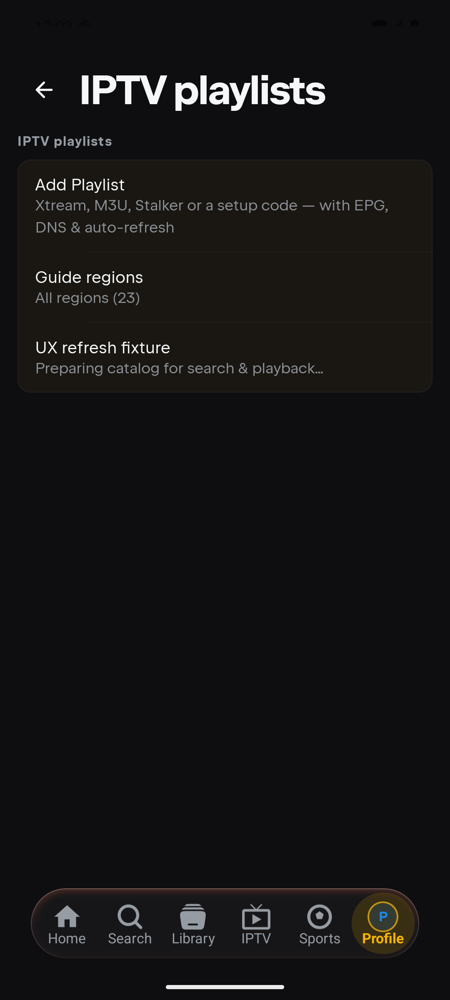
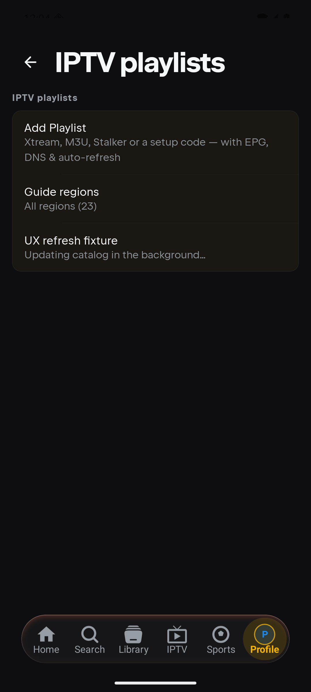
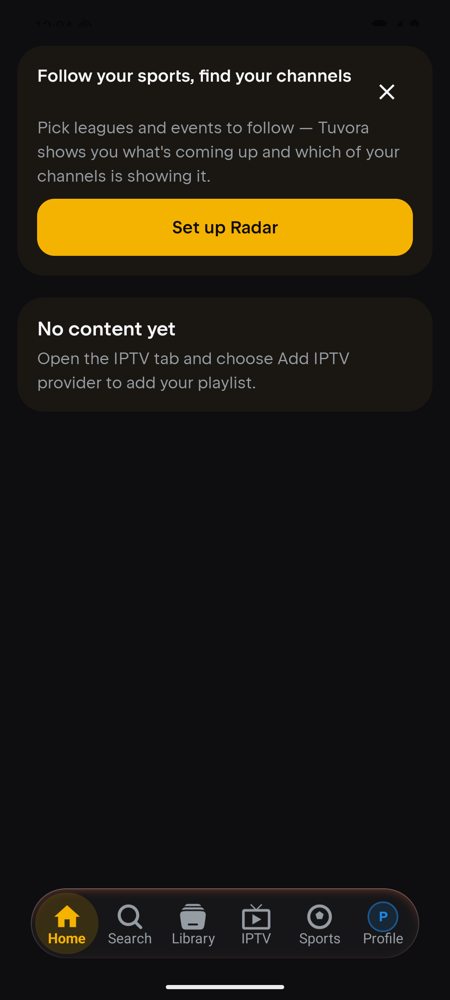

# IPTV feedback: UX28 and UX178

Android API 36 / Pixel 6 emulator, fresh guest profile; no real account or IPTV subscription. UX28 uses a localhost Xtream fixture with a previously indexed 1,001-movie catalog and a delayed refresh response. The before capture uses the earlier local debug APK; the after capture uses this branch's Play Store debug APK. These are Android captures of the shared status policy, not TV/iOS/Desktop on-device screenshots.

## UX28: refresh with an existing catalog

Before: an existing catalog says “Preparing catalog for search & playback…”.

After: “Updating catalog in the background…”. First builds retain “Preparing catalog…”; unit tests cover both initial/counting refresh states and merged catalog-kind progress.

## UX178: empty Home setup direction

The old shared string told users to add a playlist in Settings. It now names the IPTV tab and its existing Add IPTV provider action. Verified that following those directions reaches the playlist settings list; UX186 (the additional Add Playlist tap) remains separate.

## Platform checks

TV 54, Android 19, iOS Native 14, Desktop 19, tvOS Native 3: 109 tests pass with none skipped. All affected platform compiles pass. Apple TV inherits the progress fix in the shared core, but its SwiftUI playlist rows currently display no indexing status. TV and Apple TV's empty Home instructions correctly name Settings and remain unchanged. No backend/web changes.
